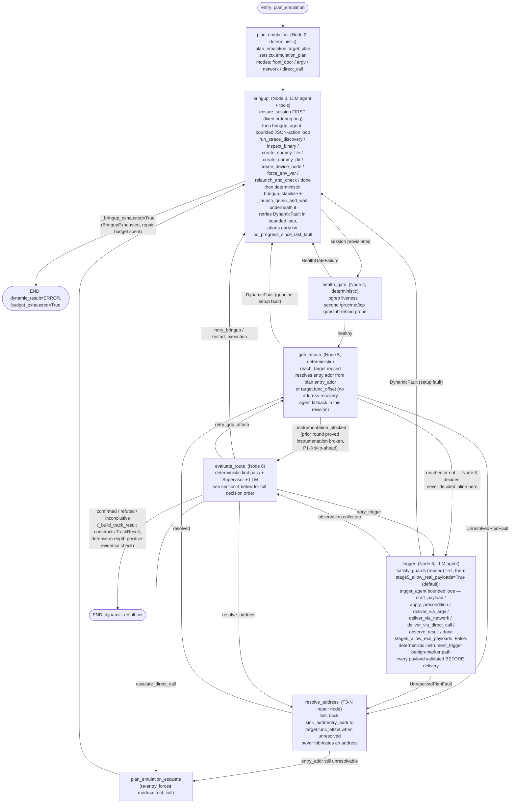
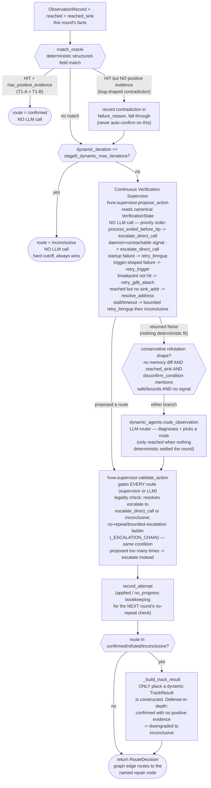
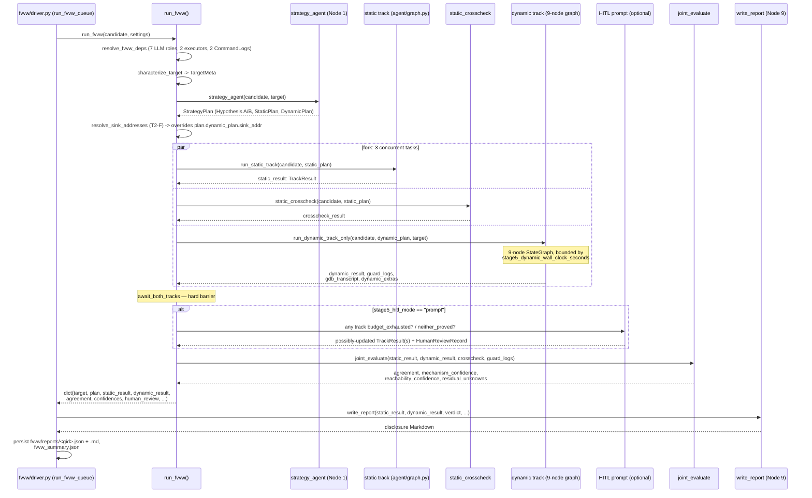

# Stage 5 — Combined Static + Dynamic Verification Workflow (FVVW v3 Fork-Join)

This document is a **reproducible diagram + reference** for the FULL Stage 5
FVVW v3 pipeline: `characterize → strategy → fork(static track, static
crosscheck, dynamic 9-node track) → join → HITL → joint_evaluate → report`.
It supersedes a single-track view — see
[STATIC_AGENT_WORKFLOW.md](STATIC_AGENT_WORKFLOW.md) for the static (Joern)
track alone, unchanged and reused verbatim here as one fork branch.

Source of truth (regenerate this diagram from these if the code changes):

- [`fvvw/graph.py`](fvvw/graph.py) — `run_fvvw()`, the actual fork-join
  orchestration; `resolve_fvvw_deps()`; `run_dynamic_track_only()`;
  `run_dynamic_only()` (the `--dynamic-only` production path).
- [`fvvw/dynamic_graph.py`](fvvw/dynamic_graph.py) — `build_dynamic_graph()`,
  the compiled 9-node `StateGraph` for Nodes 2–8.
- [`fvvw/dynamic_agents.py`](fvvw/dynamic_agents.py) — the three agentic
  tool-calling loops (`bringup_agent`, `trigger_agent`, `route_observation`).
- [`fvvw/dynamic_track.py`](fvvw/dynamic_track.py) — deterministic node
  bodies/helpers the graph closures call into.
- [`fvvw/supervisor.py`](fvvw/supervisor.py) — the Continuous Verification
  Supervisor (Tier 3): `apply_event`, `propose_action`, `validate_action`.
- [`fvvw/monitors.py`](fvvw/monitors.py) — bounded async pollers (Tier 3, T3-L).
- [`fvvw/strategy.py`](fvvw/strategy.py) — `strategy_agent()` (shared Node 1).
- [`fvvw/static_track.py`](fvvw/static_track.py) — thin adapter reusing
  `agent/graph.py::build_verifier_graph()` unmodified.
- [`tools/crosscheck_tool.py`](tools/crosscheck_tool.py) — `static_crosscheck()`,
  `resolve_sink_addresses()` (T2-F).
- [`tools/characterize_tool.py`](tools/characterize_tool.py) — `characterize_target()`.
- [`fvvw/joint.py`](fvvw/joint.py) — `joint_evaluate()`, the ONE function
  permitted to read both track results.
- [`fvvw/hitl.py`](fvvw/hitl.py) — Human-in-the-loop, hoisted after the barrier.
- [`fvvw/report.py`](fvvw/report.py) — `write_report()`, Node 9's disclosure doc.
- [`fvvw/state.py`](fvvw/state.py) — `FVVWState` + track-isolation key tuples.
- [`CLAUDE.md`](CLAUDE.md) — hard constraints, the 9-node table, the
  Continuous Verification Supervisor architecture (all authoritative).

> **Track isolation is enforced by construction** (see `fvvw/graph.py`'s
> module docstring): no static-track node reads `dynamic_*` state, no
> dynamic-track node reads `static_result` — each track is its own linear
> sequence of plain-dict-returning closures over `fvvw.state`'s
> `STATIC_TRACK_*` / `DYNAMIC_TRACK_*` key tuples. `joint_evaluate` is the
> ONLY function that reads both.

---

## 1. One-paragraph summary

One `VerificationCandidate` is verified **two independent ways** under a
single LLM-authored strategy plan (`Hypothesis A/B`, `StaticPlan`,
`DynamicPlan`, decisive-observable + oracle/disconfirm-condition pairs).
`characterize_target` builds ground-truth `TargetMeta` from the real ELF;
`strategy_agent` (Node 1, shared) emits the plan; a sink-address resolution
pass (T2-F, `resolve_sink_addresses`) overrides the plan's `sink_addr` with a
disassembly-derived call site BEFORE the fork. Three tasks then run
**concurrently**: the **static track** (the unmodified Joern generate→run→
evaluate loop — see [STATIC_AGENT_WORKFLOW.md](STATIC_AGENT_WORKFLOW.md)),
**static cross-check** (`objdump`-based corroboration, independent of the
decompiled-C-based Joern track), and the **dynamic track** (a compiled
9-node agentic `StateGraph` driving a persistent QEMU+GDB session). A hard
barrier (`await_both_tracks`) joins all three. Any track tagged
`budget_exhausted` is then optionally offered to a human operator (HITL),
strictly AFTER the barrier, never inside a track's own concurrent task.
Finally `joint_evaluate` — the ONLY function allowed to see both track
results — reconciles them into a two-axis verdict (**mechanism confidence**
× **reachability confidence**) plus an agreement classification and a list
of residual unknowns, and `write_report` (Node 9) composes the disclosure
Markdown with every raw tool output quoted verbatim.

---

## 2. Top-level fork-join diagram

```mermaid
flowchart TD
    START(["run_fvvw candidate"]) --> RESOLVE["resolve_fvvw_deps<br/>7 LLM roles + 2 executors + 2 CommandLogs"]
    RESOLVE --> CHAR["characterize_target<br/>builds TargetMeta from real ELF<br/>PIE check, dispatch_resolvable"]
    CHAR --> STRAT["strategy_agent  (Node 1, shared)<br/>one LLM pass, plain-text JSON<br/>produces StrategyPlan:<br/>Hypothesis A/B, StaticPlan, DynamicPlan<br/>oracle / disconfirm_condition pairs"]
    STRAT --> SINKRESOLVE["resolve_sink_addresses  (T2-F)<br/>objdump-derived call site OVERRIDES<br/>plan.dynamic_plan.sink_addr before fork"]

    SINKRESOLVE --> FORK{{fork: 3 concurrent tasks}}

    subgraph STATICBRANCH["Static track (agent/graph.py, unchanged)"]
        direction TB
        SSTART["run_static_track<br/>render_static_brief"] --> SLOOP["build_cpg to generate/run/evaluate loop<br/>see STATIC_AGENT_WORKFLOW.md"]
        SLOOP --> SRESULT["static_result: TrackResult"]
    end

    subgraph CROSSBRANCH["Static cross-check (independent signal)"]
        direction TB
        CSTART["static_crosscheck<br/>objdump -d -C the REAL ELF"] --> CRESULT["confirms/refutes StaticPlan<br/>expected_intermediate_calls,<br/>sanitizer_patterns"]
    end

    subgraph DYNAMICBRANCH["Dynamic track (fvvw/dynamic_graph.py, Nodes 2-8)"]
        direction TB
        DGRAPH["build_dynamic_graph + ainvoke<br/>under stage5_dynamic_wall_clock_seconds timeout<br/>see section 3 below for the full 9-node graph"]
        DGRAPH --> DRESULT["dynamic_result: TrackResult<br/>plus guard_logs, gdb_transcript,<br/>dynamic_extras (arbitration_log,<br/>observation, iteration_history,<br/>emulation_mode, verification_state)"]
    end

    FORK --> SSTART
    FORK --> CSTART
    FORK --> DGRAPH

    SRESULT --> BARRIER{{"await_both_tracks<br/>hard barrier"}}
    CRESULT --> BARRIER
    DRESULT --> BARRIER

    BARRIER --> HITLCHECK{{"stage5_hitl_mode == prompt?"}}
    HITLCHECK -- "no (default)" --> JOINT
    HITLCHECK -- "yes" --> HITLSTATIC{{"static_result<br/>budget_exhausted?"}}
    HITLSTATIC -- yes --> HITLSRUN["HITL prompt loop (static)<br/>retry / override_plan / inject /<br/>force_verdict / skip"]
    HITLSTATIC -- no --> HITLDYN
    HITLSRUN --> HITLDYN{{"dynamic_result<br/>budget_exhausted?"}}
    HITLDYN -- yes --> HITLDRUN["HITL prompt loop (dynamic)<br/>same 5 actions, may re-run<br/>run_dynamic_track_only"]
    HITLDYN -- no --> HITLNEITHER
    HITLDRUN --> HITLNEITHER{{"neither track individually<br/>exhausted AND neither_proved<br/>(both settled on none)?"}}
    HITLNEITHER -- yes --> HITLNRUN["HITL prompt loop (static,<br/>third trigger: neither_proved)"]
    HITLNEITHER -- no --> JOINT
    HITLNRUN --> JOINT

    JOINT["joint_evaluate  (fvvw/joint.py)<br/>ONLY function reading both results<br/>classify_agreement<br/>classify_mechanism_confidence<br/>classify_reachability_confidence<br/>collect_residual_unknowns"]
    JOINT --> REPORT["write_report  (Node 9)<br/>one LLM call, seven-layer disclosure<br/>doc + reconciliation section,<br/>raw tool output quoted verbatim"]
    REPORT --> PERSIST["persist: fvvw/reports/gid.json (FVVWReport)<br/>fvvw/reports/gid.md<br/>fvvw/logs/gid.static.jsonl<br/>fvvw/logs/gid.dynamic.jsonl<br/>fvvw_summary.json"]
```



---

## 3. Dynamic track — the compiled 9-node `StateGraph` (Nodes 2–8)

Node 1 (`strategy_agent`) is shared upstream (see §2); Node 9 (`write_report`)
stays downstream. Nodes 2–8 are `fvvw/dynamic_graph.py::build_dynamic_graph`,
compiled once per candidate — mirrors `agent/graph.py`'s closure-based
factory shape. Every node closure shares the SAME long-lived
`BringupContext` (`ctx`) so a loop-back edge re-enters a node and mutates
`ctx` directly — a `SessionHandle` never round-trips through graph state.



### Node reference (Nodes 2–8)

| # | Node | Kind | Function(s) | Loop-back on |
|---|---|---|---|---|
| 2 | `plan_emulation` | Deterministic | `dynamic_track.plan_emulation` — picks emulation mode (`front_door`/`argv`/`network`/`direct_call`); `plan_emulation_escalate_node` forces `direct_call` when the router asks. | — |
| 3 | `bringup` | **LLM agent + tools** | `ensure_session` (provisions session + unprivileged scratch dir) FIRST, then `dynamic_agents.bringup_agent` (bounded JSON-action ReAct loop), then deterministic `bringup_stabilize`/`_launch_qemu_and_wait`. Chroot-requiring launch + the agent's `-strace` pass run `user="root"` (per-command, never session-wide). | `health_gate` failure, `gdb_attach`/`trigger` setup faults, Node 8's `retry_bringup`/`restart_execution`. |
| 4 | `health_gate` | Deterministic | `dynamic_track.health_gate` — `pgrep` liveness + gdbstub-rebind probe. | Failure → `bringup`. |
| 5 | `gdb_attach` | Deterministic | `dynamic_track.reach_target` (reused). Stripped-symbol→address agent fallback NOT implemented this revision (flagged as future work). | `UnresolvedPlanFault` → `resolve_address`; genuine setup fault → `bringup`. |
| — | `resolve_address` | Deterministic (T3-N) | Falls `sink_addr`/`entry_addr` back to `target.func_offset`; escalates to `plan_emulation_escalate` if still unresolvable. Never fabricates an address. | → `gdb_attach` or `plan_emulation_escalate`. |
| 6 | `trigger` | **LLM agent** | `satisfy_guards` then `dynamic_agents.trigger_agent` (real-payload posture, default) or deterministic `instrument_trigger` (benign-only posture, `--benign-only`). Every payload validated (`validate_real_payload`/`validate_benign_marker`) before delivery. | `UnresolvedPlanFault` → `resolve_address`; setup fault → `bringup`. |
| 7 | (folded into 6/8) | Deterministic | `dynamic_track.collect_observation`/`collect_signals` — the trigger agent calls this itself via `observe_result`, or the deterministic path calls it directly. Produces `ObservationRecord` (signal/faulting_pc/registers/memory diff/stdout/stderr/filesystem_artifacts). | — |
| 8 | `evaluate_route` | **Deterministic first pass + Supervisor + LLM** | See §4. | `retry_bringup`/`retry_gdb_attach`/`retry_trigger`/`resolve_address`/`escalate_direct_call`, or terminal. |

---

## 4. Node 8 decision order (`_run_evaluate_route` / `evaluate_route`)

Node 8 never calls an LLM until three deterministic/semi-deterministic
checks have all declined to settle the round — this is the load-bearing
"harness decides what happened, evaluator decides what it proves" split.



**Separation of concerns (load-bearing, from `CLAUDE.md`):**
- **Supervisor** decides WHAT TO TRY NEXT (`propose_action`/`validate_action`,
  pure functions, no LLM). Never proposes `confirmed`/`refuted`.
- **Harness** (node bodies/monitors) decides WHAT ACTUALLY HAPPENED — only
  they construct a `VerificationEvent`.
- **Deterministic verifier** (`match_oracle` + `_build_track_result`'s
  empty-observation refusal) decides WHAT THE EVIDENCE PROVES — unchanged
  by the Supervisor.

---

## 5. Sequence diagram — one full fork-join round-trip



---

## 6. `joint_evaluate` — the reconciliation rule engine

Purely deterministic (no LLM call) — `fvvw/joint.py`. The ONLY function in
the whole fork-join permitted to read both `static_result` and
`dynamic_result`.

### 6a. Agreement taxonomy (`classify_agreement`)

| Agreement | Condition |
|---|---|
| `concordant_confirm` | Both tracks independently CONFIRMED. |
| `concordant_refute` | Both tracks independently REFUTED. |
| `discordant` | One CONFIRMED, the other REFUTED — genuine disagreement between two independent witnesses. |
| `one_sided` | Exactly one track reached a definite verdict (CONFIRMED/REFUTED); the other is INCONCLUSIVE/ERROR. |
| `neither` | NEITHER track reached a definite verdict — distinct from `one_sided` (zero witnesses vs. one). |

### 6b. Mechanism confidence (`classify_mechanism_confidence`)

| Agreement | Mechanism confidence |
|---|---|
| `concordant_confirm` | `confirmed_strong` (multi-signal, two independent witnesses) |
| `discordant` | `discordant_hold` — **ALWAYS**, never auto-resolved by trusting one track. Requires human review. |
| `neither` | `inconclusive`, named explicitly |
| `one_sided`, surviving track CONFIRMED | `confirmed_single_track` |
| `one_sided`, surviving track REFUTED, or anything else | `inconclusive` |

### 6c. Reachability confidence (`classify_reachability_confidence`)

Independent axis — never collapsed with mechanism confidence (FVVW's
two-axis-truth principle).

| Condition | Reachability confidence |
|---|---|
| Any guard was FORCED to reach the sink | `forced_unknown` — caps confidence, never raised even by a `confirmed_strong` mechanism. |
| `concordant_refute` AND dynamic never reached the sink | `refuted` |
| Dynamic reached sink AND crosscheck didn't contradict | `confirmed` |
| Crosscheck confirmed calls OR dynamic reached sink (partial) | `conditional` |
| Dynamic-reached-sink unknown (`None`) | `conditional` |
| Otherwise | `refuted` |

### 6d. Residual unknowns (`collect_residual_unknowns`)

Carries forward every honest caveat verbatim — never silently dropped:
static track's own `recommended_next_steps`; guards forced away from their
real default value; cross-check calls not all confirmed; either track
landing on INCONCLUSIVE/ERROR; a REFUTED verdict lacking a positively-proved
hypothesis B (defense-in-depth — should be structurally impossible, flagged
anyway); any HITL `force_verdict` human-attributed verdict, with its
rationale.

---

## 7. HITL — hoisted after the barrier, never inside a track

`fvvw/hitl.py`. **Never runs inside a track's own concurrent task** — the
prompt is hoisted to `run_fvvw`, strictly AFTER `await_both_tracks` and
BEFORE `joint_evaluate`, so a blocking prompt can't interleave stdout with a
sibling candidate's own task in the worker pool. `--hitl=prompt` forces
`stage5_workers=1` for exactly this reason.

Three independent triggers, each checked after the barrier:

1. **`static_result` is `budget_exhausted`** → offer HITL on the static track.
2. **`dynamic_result` is `budget_exhausted`** → offer HITL on the dynamic track.
3. **`neither_proved`** — neither track individually exhausted its budget,
   but both settled on `"none"` (`Agreement.NEITHER`) — offers the static
   track for review, since two honestly-inconclusive tracks would otherwise
   sail into `joint_evaluate` with no human ever seeing them.

Five possible operator actions per round (bounded by
`stage5_hitl_max_rounds`): `retry` (extra iterations), `override_plan`,
`inject` (raw script/GDB recipe — gated by its own containment checks, never
`validate_benign_marker`/`validate_real_payload`), `force_verdict`, `skip`.
A `force_verdict` or exhausted round produces a `HumanReviewRecord`,
persisted on `FVVWReport.human_review`; `residual_unknowns` tags every
human-attributed track explicitly.

---

## 8. Containment & privilege model (dynamic track only)

- **Containment is structural, not content-based.** `stage5_allow_real_payloads`
  (default `True`) lets the trigger agent craft the ACTUAL malicious input a
  hypothesis calls for; `validate_real_payload` hard-blocks only weaponized
  content (reverse shells, exfiltration, destructive host commands) — not
  "realistic" content generally. Containment comes from the disposable,
  resource-capped, `--network=none` sandbox container, not from restricting
  payload content.
- **Session privilege escalation is per-command, never session-wide.** The
  session container always starts non-root; only the chroot-requiring QEMU
  launch and the bring-up agent's `-strace` discovery pass run as root
  (`_bringup_exec_user`), gated by `stage5_sandbox_allow_privileged`.
- **HITL's `inject` action gets its own gate** (`validate_injected_recipe`)
  — a GDB-escape-hatch check (`shell`/`!`/`pipe`/`python`/`define`/`source`/
  `dump`) enforced unconditionally, regardless of `stage5_allow_real_payloads`.

---

## 9. Surrounding call chain (production entry points)

```
fw-verify run --db-subfolder data/db/<stem>                  # fork-join (default)
  → fvvw/driver.py::run_fvvw_queue()
    → candidate_index.discover_candidates()                   # stage3/findings + stage2_summary
    → fvvw/graph.py::run_fvvw()                                 (THIS diagram, §2-§7)
  → persists: fvvw/reports/<gid>.json (FVVWReport), fvvw/reports/<gid>.md,
              fvvw/dynamic_workspace/<gid>/, fvvw/logs/<gid>.{static,dynamic}.jsonl,
              fvvw_summary.json

fw-verify run --joern-only                                    # static track alone
  → driver.py::run_queue() → agent/verifier.py::verify_candidate()
  → see STATIC_AGENT_WORKFLOW.md for the full diagram

fw-verify run --dynamic-only                                  # dynamic track alone
  → fvvw/driver.py::run_dynamic_only_queue()
    → fvvw/graph.py::run_dynamic_only()                        # characterize -> strategy ->
                                                                 # dynamic track alone, no
                                                                 # static/crosscheck/joint_evaluate
  → persists: fvvw/dynamic_only/reports/<gid>.json (DynamicOnlyReport),
              fvvw/dynamic_only/reports/<gid>.md, fvvw_dynamic_only_summary.json
```

---

## 10. Reproducing this diagram after a code change

1. Re-read `fvvw/graph.py::run_fvvw` — confirm the fork/barrier/HITL/
   joint_evaluate ordering still matches §2 and §5.
2. Re-read `fvvw/dynamic_graph.py::build_dynamic_graph` — confirm node names,
   `add_conditional_edges` targets, and `_ROUTE_TO_NODE` still match §3.
3. Re-read `_run_evaluate_route` — confirm the deterministic-first-pass →
   Supervisor → LLM-router decision order still matches §4.
4. Re-read `fvvw/joint.py`'s three classifier functions — confirm §6's
   tables.
5. Re-check `CLAUDE.md`'s hard constraints and "The 9 nodes" / "Continuous
   Verification Supervisor" sections for anything newly documented, and
   fold it in here.
6. As with the static-only diagram, there is no auto-export step — this
   file is the maintained source of truth, hand-updated alongside the code.

---

*Generated from `fw_audit/stage5_verification/fvvw/graph.py`,
`fvvw/dynamic_graph.py`, `fvvw/joint.py`, `fvvw/hitl.py`, and `CLAUDE.md` as
of the `fix/fvvw-gdb-codegen-trigger-shape-gate` branch, 2026-09-22.*
