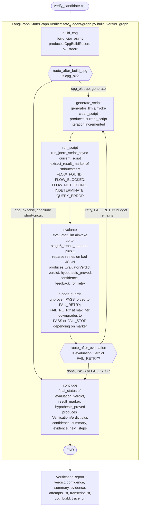

# Stage 5 Static (Joern) Verification Agent — Workflow Diagram

This document is a **reproducible diagram + reference** for the Stage 5
static verification track: the Joern-based generate → run → evaluate loop
that has been unchanged since v1. It is reused **verbatim** by the FVVW v3
fork-join (`fvvw/static_track.py` is a thin adapter around it) and is also
reachable standalone via `fw-verify run --joern-only`.

Source of truth (regenerate this diagram from these if the code changes):

- [`agent/graph.py`](agent/graph.py) — the compiled `LangGraph` `StateGraph`
  (`build_verifier_graph`), node bodies, and conditional-edge routers.
- [`agent/verifier.py`](agent/verifier.py) — `verify_candidate()`, the
  pipeline's single entry point (candidate in → `VerificationReport` out).
- [`agent/prompts.py`](agent/prompts.py) — `GENERATOR_SYSTEM_PROMPT`,
  `EVALUATOR_SYSTEM_PROMPT`, `render_finding_brief`.
- [`agent/transcript.py`](agent/transcript.py) — per-node `TranscriptEntry`
  construction (the live, turn-by-turn record).
- [`tools/joern_tool.py`](tools/joern_tool.py) — the exact Joern CLI
  commands (`build_cpg_async`, `run_joern_script_async`).
- [`driver.py`](driver.py) — the production worker-pool caller
  (`run_queue()`, `fw-verify run --joern-only`).
- [`report_writer.py`](report_writer.py) — renders the persisted
  `VerificationReport` to Markdown.

> **Hard constraint (see [`CLAUDE.md`](CLAUDE.md)):** `agent/graph.py` and
> `agent/prompts.py` are reused **unchanged** by FVVW feature work — only
> genuine correctness fixes to the loop itself land here, and any such fix
> must be documented in `CLAUDE.md`'s hard-constraints section. This diagram
> reflects the **current, positive-proof-hardened** version of that loop.

---

## 1. One-paragraph summary

One `VerificationCandidate` (a Stage 3 finding + its Joern-normalized
whole-program C, resolved via `candidate_index.py`) drives a single
LangGraph `StateGraph`: build a Code Property Graph (CPG) from the
candidate's source once, then loop **generate a CPGQL script → run it in
the Joern sandbox → evaluate the result** until the evaluator LLM
positively proves hypothesis **A** (vulnerable) or **B** (safe/blocked), or
the iteration budget (`stage5_max_agent_iterations`) is exhausted — at
which point `conclude` derives a final `VerificationVerdict`
(`CONFIRMED` / `REFUTED` / `INCONCLUSIVE` / `ERROR`). Two independently
swappable LLM roles do the work (`STAGE5_SCRIPT_GENERATOR`,
`STAGE5_RESULT_EVALUATOR`); neither uses tool-calling or
`with_structured_output` — both are plain `.ainvoke(messages) → AIMessage`
text in/text out calls, deliberately, for reliable behavior on local models
(e.g. `qwen3:32b`).

---

## 2. Graph diagram (Mermaid — matches `build_verifier_graph()` exactly)



---

## 3. Node reference table

| Node | Kind | Function | Reads | Produces | Notes |
|---|---|---|---|---|---|
| `build_cpg` | Deterministic (Docker/Joern) | `build_cpg_async()` (`tools/joern_tool.py`) via `SandboxExecutor.run()` | `workspace_dir`, `candidate.source_path` (copied in as the workspace's source file) | `cpg_ok`, `cpg_stderr` | Runs once per candidate, never re-run inside the retry loop. |
| `route_after_build_cpg` | Pure router | — | `cpg_ok` | `"generate"` \| `"conclude"` | CPG failure short-circuits straight to `conclude` — a deliberate divergence from the ported pipeline (which raised), so every candidate still yields a persisted `VerificationReport` (status `ERROR`) instead of burning a queue retry. |
| `generate_script` | LLM (generator) | `build_generator_messages()` (`agent/prompts.py`) → `generator_llm.ainvoke()` → `clean_script()` | `brief`, `system_prompt`, `generator_feedback` (from the previous `evaluate` round), previous attempt's script/stdout/stderr | `current_script`, `iteration` (incremented) | No tool-calling — plain text-in/text-out. Feedback loop is the ONLY way the generator sees why its last script didn't settle anything. |
| `run_script` | Deterministic (Docker/Joern) | `run_joern_script_async()` (`tools/joern_tool.py`) | `current_script` | `execution_stdout/stderr/returncode/ok`, `result_marker` | `extract_result_marker()` is a line-anchored regex (`^RESULT: <MARKER>`) — a script that merely *mentions* a marker in a comment can't mint a false verdict. |
| `evaluate` | LLM (evaluator) + deterministic guards | `build_evaluator_messages()` → `evaluator_llm.ainvoke()` (up to `stage5_repair_attempts + 1` reparse retries on malformed JSON) → `parse_evaluator_response()` | `brief`, `current_script`, execution stdout/stderr/returncode | `evaluation_verdict`, `hypothesis_proved` (`"A"`/`"B"`/`"none"`), `evaluation_confidence`, `generator_feedback` | **Positive-proof discipline** (see §4): an unproven `PASS` (`hypothesis_proved=="none"`) is forced to `FAIL_RETRY`. At `max_iterations`, a `FAIL_RETRY` that *did* print a marker downgrades to `PASS` (→ `INCONCLUSIVE`); one that never printed a marker downgrades to `FAIL_STOP` (→ `ERROR`). |
| `route_after_evaluation` | Pure router | — | `evaluation_verdict` | `"retry"` \| `"done"` | Loops back to `generate_script` only on `FAIL_RETRY`. |
| `conclude` | Deterministic | `final_status()` | `evaluation_verdict`, `result_marker`, `hypothesis_proved`, or (CPG-failure path) `cpg_stderr` | `verdict`, `verdict_confidence`, `verdict_summary`, `verdict_evidence`, `verdict_next_steps` | The ONLY place a final `VerificationVerdict` is minted — see `final_status()` mapping in §4. |

---

## 4. Verdict derivation (`final_status()`, `agent/graph.py`)

`conclude` never calls an LLM — the verdict is a pure function of the last
evaluator round's fields:

```
evaluation_verdict != PASS                → ERROR
hypothesis_proved == "A"                  → CONFIRMED
hypothesis_proved == "B"                  → REFUTED
hypothesis_proved == "none"               → INCONCLUSIVE
(hypothesis_proved absent — legacy path,   → marker-only mapping:
 e.g. HITL-injected scripts with no          FLOW_FOUND            → CONFIRMED
 evaluator round to source a judgement       FLOW_BLOCKED/NOT_FOUND → REFUTED
 from; a human vouched for those directly)   else                   → INCONCLUSIVE
```

**Cardinal rule (why this exists):** CONFIRMED/REFUTED require *positive*
proof — a bare empty `reachableByFlows` result must never mint a
refutation on its own, since it's equally consistent with a malformed
query, an unmodeled propagator (`sprintf`/`strcpy`/`memcpy`/...), or a
method the CPG's `ReachingDefPass` silently skipped.

### Result-marker vocabulary (printed by the generated script, parsed by `extract_result_marker`)

| Marker | Hypothesis | Meaning |
|---|---|---|
| `FLOW_FOUND` | A | A concrete tainted source→sink flow was demonstrated. |
| `FLOW_BLOCKED` | B (strong) | A named sanitizer/guard/constant provably blocks the flow. |
| `FLOW_NOT_FOUND` | B (weaker) | No flow found — legal only once the generator's CHECK-1/2/3 health checks (and a two-legged bridging query, where a propagator sits on the path) corroborate the absence. |
| `INDETERMINATE` | none | Neither proved; health checks failed. |
| `QUERY_ERROR` | none | The script itself couldn't run. |

---

## 5. Sequence diagram — one full round-trip (retry case)

```mermaid
sequenceDiagram
    participant Driver as driver.py / fvvw.static_track
    participant Verifier as verify_candidate()
    participant Graph as StateGraph (LangGraph)
    participant Gen as generator_llm
    participant Sandbox as Joern (SandboxExecutor)
    participant Eval as evaluator_llm

    Driver->>Verifier: verify_candidate(candidate, settings, on_step?)
    Verifier->>Verifier: resolve STAGE5_SCRIPT_GENERATOR / STAGE5_RESULT_EVALUATOR LLMs
    Verifier->>Verifier: render_finding_brief(candidate)
    Verifier->>Graph: ainvoke(initial_state) / astream(..., "values")

    Graph->>Sandbox: build_cpg_async() [build_cpg node]
    Sandbox-->>Graph: CpgBuildRecord(ok=True, stderr)
    Note over Graph: route_after_build_cpg → "generate"

    loop until PASS/FAIL_STOP or max_iterations
        Graph->>Gen: build_generator_messages(brief, feedback, prev attempt) [generate_script]
        Gen-->>Graph: script text
        Graph->>Sandbox: run_joern_script_async(script) [run_script]
        Sandbox-->>Graph: stdout/stderr/returncode + RESULT: marker
        Graph->>Eval: build_evaluator_messages(brief, script, stdout, stderr) [evaluate]
        Eval-->>Graph: EvaluatorVerdict{verdict, hypothesis_proved, feedback_for_retry}
        Note over Graph: unproven PASS → forced FAIL_RETRY;<br/>max_iterations exhaustion → PASS or FAIL_STOP
        Graph->>Graph: route_after_evaluation
        alt FAIL_RETRY (budget remains)
            Graph->>Gen: loop back to generate_script (carries feedback)
        else PASS or FAIL_STOP
            Graph->>Graph: conclude → final_status()
        end
    end

    Graph-->>Verifier: final_state (verdict, transcript[], attempts[])
    Verifier-->>Driver: VerificationReport
    Driver->>Driver: persist verifications/<gid>.json, reports/<gid>.md
```

---

## 6. State shape (`VerifierState`, `agent/graph.py`)

```
brief, system_prompt, max_iterations        # static inputs (seeded once)
cpg_ok, cpg_stderr                           # CPG build
iteration, current_script, generator_feedback # generate/retry loop
execution_stdout, execution_stderr,
execution_returncode, execution_ok,
result_marker                                # execution
evaluation_verdict, evaluation_reasoning,
evaluation_confidence, hypothesis_proved     # evaluation
verdict, verdict_confidence, verdict_summary,
verdict_evidence, verdict_next_steps         # conclusion
transcript: Annotated[list[TranscriptEntry], operator.add]  # append-only
```

`transcript` uses LangGraph's `operator.add` reducer — each node returns
only ITS OWN new entries, which the graph appends to the running list
rather than overwriting it, mirroring how the old tool-calling graph used
`add_messages`.

---

## 7. Surrounding call chain (how a candidate reaches this graph)

```
fw-verify run --joern-only
  → driver.py::run_queue()                         (worker pool over candidates)
    → candidate_index.discover_candidates()         (reads stage3/findings/*.json
                                                       + stage2/stage2_summary.json)
    → agent/verifier.py::verify_candidate()          (resolves LLMs, builds graph,
                                                       copies source into workspace)
      → agent/graph.py::build_verifier_graph()       (THIS diagram)
      → graph.ainvoke() / astream(..., "values")     (on_step callback for --live)
    → report_writer.py                               (VerificationReport → Markdown)
  → persists: stage5/verifications/<gid>.json,
              stage5/reports/<gid>.md,
              stage5/workspace/<gid>/ (kept iff --keep-workspace),
              stage5/stage5_summary.json
```

The FVVW v3 fork-join reuses the exact same graph: `fvvw/static_track.py`
renders a strategy-enriched brief on top of `render_finding_brief` and
calls `build_verifier_graph()` unmodified, mapping the terminal state into
a `TrackResult` instead of a standalone `VerificationReport`.

---

## 8. Reproducing this diagram after a code change

1. Re-read `agent/graph.py::build_verifier_graph` — confirm node names,
   `add_conditional_edges` targets, and `route_after_*` return values still
   match §2/§3.
2. Re-read `final_status()` — confirm §4's derivation table.
3. Re-read `extract_result_marker`'s regex and the generator/evaluator
   system prompts (`agent/prompts.py`) — confirm §4's marker vocabulary.
4. Re-check `CLAUDE.md`'s "Hard constraints" section for any newly
   documented correctness fix to this loop (the one class of change
   permitted here) and fold it into §2–§4.
5. Regenerate the Mermaid blocks by hand-walking the graph — there is no
   auto-export step in this codebase; treat this file as the maintained
   source of truth for the diagram, not a generated artifact.

---

*Generated from `fw_audit/stage5_verification/agent/graph.py`,
`agent/verifier.py`, `agent/prompts.py`, and `CLAUDE.md` as of the
`fix/fvvw-gdb-codegen-trigger-shape-gate` branch, 2026-09-21.*
